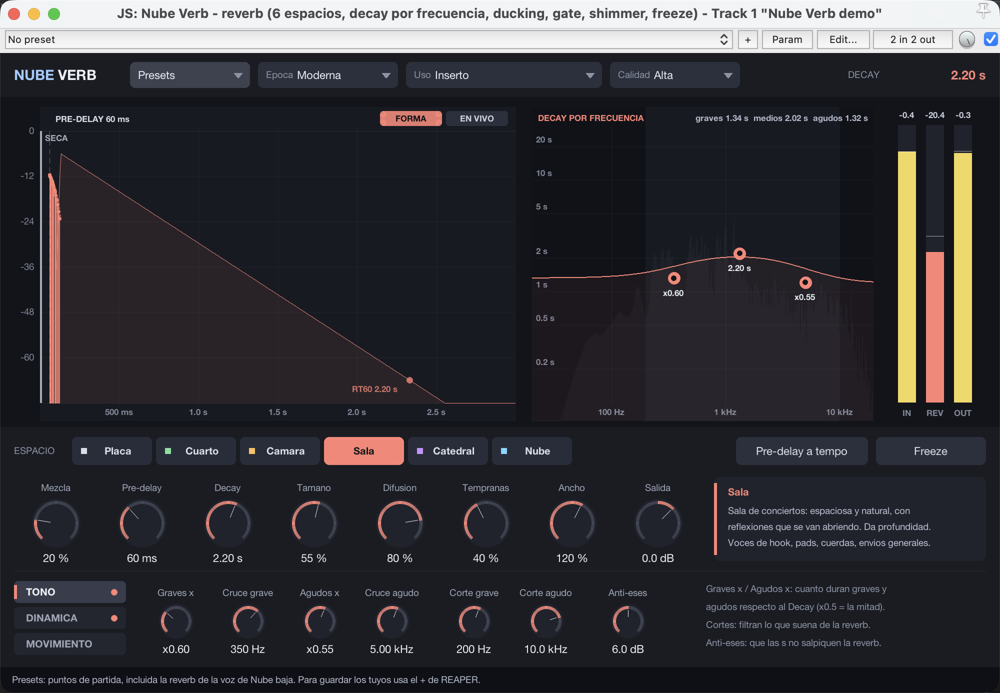

<!-- en -->
# Nube Verb

A free algorithmic reverb for [REAPER](https://www.reaper.fm), written as a JSFX (macOS / Windows / Linux), part of the
[Nube plugins](https://github.com/KevinMeneses/nube-plugins).



16-line feedback delay network, 6 spaces (Plate, Room, Chamber, Hall, Cathedral, Cloud), decay 0.1–20 s with low/high multipliers, tempo-synced pre-delay, size, diffusion, early reflections, modulation, de-essing of the tail, ducking, gate, shimmer, freeze, vintage modes and 14 presets. ~4.5 % CPU.

**Install** — with [ReaPack](https://reapack.com): *Extensions → ReaPack → Import repositories*, paste
`https://github.com/KevinMeneses/nube-plugins/raw/main/index.xml`, then install **Nube Verb**. Or copy `nube_verb.jsfx`
into `REAPER/Effects/Nube Verb/` (on macOS `./install.sh` links it). It shows up as **JS: Nube Verb**. The interface is in Spanish.

**How it was made** — designed and built with [Claude Code](https://claude.com/claude-code). Since an AI can't
listen, every feature is verified by rendering test cases inside REAPER and comparing them with the theory
(`tests/run.sh`), plus mouse-driven UI tests (`tests/ui_test.py`).

**License** — GPL-3.0-or-later (see `LICENSE`).

---

## Español
Reverb para REAPER (JSFX, macOS/Windows/Linux), hermana de [Nube EQ](https://github.com/KevinMeneses/nube-eq) y [Nube Comp](https://github.com/KevinMeneses/nube-comp): fácil de
usar, con todo lo de una reverb de pago y seis espacios con carácter propio.


- **6 espacios**:
  - **Placa** (estilo EMT 140): densa y brillante desde el primer instante. Voz de rap, snare, clap.
  - **Cuarto**: reflexiones tempranas marcadas y cola corta. Batería, guitarras, voces dobladas.
  - **Cámara** (cámara de eco de estudio): dura y pareja, medios presentes. Rhodes, keys, coros.
  - **Sala**: espaciosa y natural. Voces de hook, pads, envíos generales.
  - **Catedral**: enorme, reflexiones lejanas y cola que crece despacio.
  - **Nube**: espacio irreal, muy modulado y suave. Ambient, chill trap, pads.
- **Decay** de 0.1 a 20 s (RT60 real, medido) y **decay por frecuencia**: graves ×, agudos × y sus cruces, editables
  arrastrando los puntos de la curva.
- **Pre-delay** hasta 500 ms o **a tempo** (1/64 a 1/4, con tresillos y puntillos). **Tamaño**, **difusión**,
  **tempranas**, **ancho** (0–200 %), **modulación** con velocidad.
- **Cortes** grave y agudo de la reverb, y **anti-eses**: baja las s antes de que entren a la reverb (la señal seca no
  se toca).
- **Ducking**: la reverb baja mientras suena la voz y sube en los silencios. **Gate**: corta la cola con hold
  (snare de los 80).
- **Shimmer**: la cola vuelve a entrar subida de tono (+12, +7, +5, +19, +24 o −12).
- **Freeze**: congela la cola para siempre.
- **Época**: Moderna, 80s (más brillante, algo de grano) o 70s (oscura y cálida).
- **Uso**: Inserto (seca + reverb) o **Envío** (100 % húmeda, para una pista de retorno).
- **Calidad**: Alta (16 líneas) o Eco (8 líneas).
- Gráficas: **respuesta al impulso** (pre-delay, tempranas, cola, RT60, gate, freeze) o **en vivo** (entrada, reverb y
  ducking/gate), **curva de decay por frecuencia** con el espectro de la reverb detrás, medidores IN/REV/OUT.
- Ayuda en el pie de la ventana de todo lo que tienes bajo el mouse; cada espacio y cada pestaña traen su explicación.
- CPU: ~4.5 % de un núcleo por instancia (~6 % con todo encendido; Eco ~4 %).

## Instalar

```sh
./install.sh
```

Crea un enlace en `~/Library/Application Support/REAPER/Effects/Nube Verb/`. En REAPER aparece como
**JS: Nube Verb** en el navegador de FX. Si cambias el código, vuelve a insertar el FX.

## Cómo se usa

| Acción | Cómo |
|---|---|
| Decay | Perilla, **arrastrar izquierda/derecha en la respuesta**, o arrastrar el punto del medio de la curva |
| Tamaño | Perilla o **arrastrar arriba/abajo en la respuesta** |
| Pre-delay | Perilla o **arrastrar la línea punteada** de la respuesta |
| Graves / agudos | Puntos de la curva: **izquierda/derecha = cruce**, **arriba/abajo = cuánto duran**; doble clic = valor por defecto |
| Perillas | Arrastra arriba/abajo o usa la rueda; **Shift** = fino; **doble clic** = valor por defecto |
| Presets | Botón *Presets* o clic derecho en las gráficas |
| Más controles | Pestañas **Tono**, **Dinámica** y **Movimiento** (el punto indica que hay algo encendido) |
| Reiniciar máximos | Clic en los medidores |

### Reverb en envío (recomendado para voces)

1. Crea una pista de retorno con Nube Verb y pon **Uso = Envío** (o el preset *Voz Tonor - Reverb*).
2. Envía las voces a esa pista. Ajusta cuánta reverb lleva cada una con el nivel del envío.

## Presets

| Preset | Qué hace |
|---|---|
| Voz rap - placa corta | Placa 0.9 s, pre 25 ms, 15 %, corte 250 Hz / 9 kHz, anti-eses 6, ducking 6 dB |
| Voz Tonor - Reverb (Nube baja) | El retorno "Voz · Reverb" de *Voz Tonor 6* (de-esser + EQ + ReaVerbate) medido: envío, Sala 0.42 s, pre 62 ms, corte 500 Hz / 6.5 kHz, anti-eses 6, +7 dB |
| Voz hook - sala amplia | Sala 2.2 s, pre 60 ms, 20 %, ancho 120 %, ducking 8 dB |
| Voz chill - Nube oscura | Nube 3.5 s, pre 80 ms, agudos ×0.35, corte 6 kHz, modulación 50 % |
| Voz - ambiente corto | Cuarto 0.45 s, tempranas 80 %: cuerpo sin cola |
| Snare / clap - placa brillante | Placa 1.3 s, pre 10 ms, agudos ×0.8 |
| Snare 80s con gate | Sala 3 s, gate −30 dB / hold 280 ms, época 80s |
| Batería - cuarto | Cuarto 0.6 s, tempranas 70 % |
| Rhodes / keys - cámara | Cámara 1.6 s, ancho 120 % |
| Guitarra / arpegios 70s | Placa 2.2 s, época 70s, modulación 45 % |
| Pads infinitos (Nube) | Nube 12 s, 40 %, modulación lenta |
| Shimmer celestial | Nube 8 s, shimmer 45 % +12 |
| Catedral | Catedral 6 s |
| Por defecto | Sala 2 s, 25 % |

## Estructura

- `src/nube_verb.template.jsfx`: el código (DSP + interfaz). **Editar este** y correr `python3 tools/build.py`.
- `nube_verb.jsfx`: generado. La red de 16 líneas y las tempranas van desenrolladas con variables sueltas
  (en EEL2 es ~2.5× más rápido que con arreglos).
- `tests/run.sh`: renderiza 54 casos en una pestaña temporal de REAPER y los compara con la teoría (53 chequeos, más
  que ningún render tenga NaN ni se dispare): mezcla y salida exactas, envío sin seca, RT60 (0.5/2/6 s, Eco, con
  modulación, los 6 espacios ±15 %), graves/agudos ×, pre-delay en ms y a tempo (±0.6 ms), ancho (mono exacto,
  correlación ~0), cortes, época, ducking (−12.0 dB), gate, shimmer arriba/abajo y que al máximo se apague,
  anti-eses (−10 dB en las s, 0 dB en vocales), freeze y los 14 presets.
- `tests/ui_test.py` (+ `ui.py`, `ui_dump.lua`, `scroll.swift`, `reopen.sh`): pruebas de la interfaz con el mouse
  (`cliclick`, 16 chequeos). `tests/reopen.sh` abre la demo; `tests/ui_close.lua` la cierra.
- `tests/perf.lua`: CPU. `tests/demos.lua`: voz seca por 6 presets en `demos/`.
- `tests/compara_voz_tonor.lua` + `.py`: compara la cadena de reverb de voz original con Nube Verb (RT por octava,
  inicio, espectro, nivel).

## Detalles técnicos

- Red de retardos con realimentación (FDN) de 16 líneas (8 en Eco), matriz de Hadamard, un allpass dentro de cada
  línea (densidad) y modulación senoidal por línea con interpolación lineal (calculada cada 16 muestras e
  interpolada).
- Decay por frecuencia: en cada línea, estante grave y agudo de primer orden (TPT) con las ganancias exactas para el
  RT60 de graves, medios y agudos según el largo de esa línea (incluido su allpass). Freeze = ganancias 1 y entrada
  cerrada.
- Entrada: anti-eses (split Linkwitz-Riley de 4º orden en 4.5 kHz, detección relativa agudos/total, sin depender del
  nivel), saturación de época, pre-delay interpolado (sin clics al moverlo), 4 allpass de difusión por lado.
- Tempranas: 16 ecos por lado, tiempos y signos fijos por espacio, ventana según espacio y tamaño.
- Shimmer: pitch shifter de dos cabezas (ventana de 50 ms, fundido sin² + cos² = 1) sobre la cola, con pasa-altos
  150 Hz y pasa-bajos 7 kHz, normalizado para que al máximo la cola igual se apague (y con un limitador suave de
  seguridad).
- Mezcla de potencia constante (seca × cos, húmeda × sin): el volumen no cambia al mover la mezcla.
- Medido contra ReaVerbate: colas igual de densas (curtosis ≈ 3 desde 50–80 ms) y con coloración parecida o menor
  (desviación del espectro de la cola 5.7–6.6 dB vs 6.3; Cuarto/Placa sin modulación ~7.5).
- Trampas de EEL2 (las mismas del EQ y el Comp): variables sin distinción de mayúsculas, nada de notación
  científica, las funciones se definen antes de usarse (si no, REAPER deja pasar el audio sin procesar), y la
  interfaz corre en otro hilo: la interfaz pide recalcular con `upd = 1` y el audio lo hace en `@block`.

Nota sobre las pruebas: necesitan REAPER y Python con numpy, scipy y soundfile (`NUBE_PY=/ruta/a/python tests/run.sh`). Los casos con voz o música real usan grabaciones propias que no están en el repo (`tests/signals/`); sin ellas esos casos no se pueden correr.
